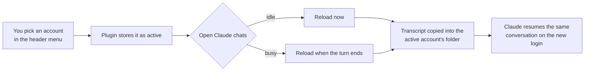

<div align="center">

# Claude accounts for Paseo

**Several Claude logins, one Claude provider, one click to switch.**

When one account hits its limit, switch to the next and keep going in the same chat, with the whole history.

[](https://paseo.sh)
[](https://docs.anthropic.com/en/docs/claude-code)
[](LICENSE)

</div>

---

## Why

Claude Code keeps one login per config directory. Paseo can run several of them as separate providers, but then every model shows up once per account in the pickers, and a chat stays stuck on the account it was started on.

This plugin keeps **one** Claude provider in Paseo and puts any number of logins behind it. You choose which login the next message goes out on; open chats move over with their history.

## Features

|  |  |
|---|---|
| **One provider in the pickers** | Every model shows once. The accounts live in the config but stay out of the pickers. |
| **Switch from the header** | A button in every workspace with a Claude chat shows the account in use and opens a native Paseo menu with each account and its usage. |
| **Chats keep their history** | Switching reloads open Claude chats on the new login and resumes the same conversation. Busy chats move once their turn ends. |
| **Usage at a glance** | Session (5h) and weekly usage per account, in the menu and in Paseo's own usage bar. |
| **Manage in Settings** | Add an account, sign it in (browser or code, works from your phone too), sign in again, or remove it. |

## Requirements

- [Paseo](https://paseo.sh) **0.13.0 or newer**, with plugins enabled
- [Claude Code](https://docs.anthropic.com/en/docs/claude-code) (`claude`) on your `PATH`: signing in runs `claude auth login`
- `npm` on your `PATH`: Paseo runs `npm ci` once when it installs the plugin

## Install

```sh
paseo plugin install github:MaxGierlachowski/paseo-multi-account
```

On macOS the CLI ships inside the app: `/Applications/Paseo.app/Contents/Resources/bin/paseo`.

Paseo asks you to trust the plugin (plugins run unsandboxed), clones it, installs its dependencies and loads it. If nothing shows up, check that `~/.paseo/config.json` has `"pluginsEnabled": true` and restart Paseo.

## Getting started

1. Open **Settings → Plugins → Claude accounts**.
2. Under **Add account**, enter a name such as `Work` and press **Add**. The plugin adds a provider `claude-work` with its own `~/.claude-work` folder and starts the sign-in.
3. Finish the sign-in in the browser that opens, or open the link on any device and paste the code into the **Code** field.
4. Repeat for every login you have.
5. Start chats on the built-in **Claude** provider as usual. With two or more accounts, the account button appears in the workspace header.

## Everyday use

| You want to | Where |
|---|---|
| Switch account | Header button → pick an account |
| See usage per account | Header button, or Paseo's usage bar |
| Add an account | Settings → Plugins → Claude accounts → **Add account** |
| Sign in again (expired login) | Settings → Plugins → Claude accounts → **Sign in again** |
| Remove an account | Settings → Plugins → Claude accounts → **Remove** (not the one in use) |

Switching is global: new chats, reopened chats and every open Claude chat move to the chosen account.

## How it works



- Each account is a provider in `agents.providers` that extends `claude`, sets its own `CLAUDE_CONFIG_DIR` and is **disabled**, so it stays out of the pickers.
- Before Paseo opens any Claude session, the plugin points `CLAUDE_CONFIG_DIR` at the active account.
- Claude Code stores a conversation under the login that ran it. Before a chat reopens on another login, the plugin copies that one session's transcript over; the source is never changed.
- Removing an account only takes its provider out of the config. The login and its folder stay on disk, and the folder keeps being searched for transcripts, so old chats keep their history.

An account the plugin adds looks like this in `~/.paseo/config.json`:

```json
"claude-work": {
  "extends": "claude",
  "label": "Claude (Work)",
  "enabled": false,
  "env": { "CLAUDE_CONFIG_DIR": "/Users/you/.claude-work" },
  "options": { "extraArgs": { "chrome": null } }
}
```

More detail, including the internals, is in [OVERVIEW.md](OVERVIEW.md).

## Good to know

- **Start chats on Claude, not on an account provider.** Account providers are disabled, and in Paseo 0.13 a disabled provider's chats don't open. If you have chats created directly on one, set `"provider": "claude"` in their records under `~/.paseo/agents/` (top level, `runtimeInfo` and `persistence`) and restart Paseo.
- **No confirmation toast in the header menu.** Paseo's menus can't show one; the button's label changing to the new account is the confirmation.
- Plugin state (the active account, removed accounts' folders) lives in `~/.paseo/claude-accounts.json`.

## Update and uninstall

```sh
paseo plugin update claude-accounts-usage    # pull the latest version
paseo plugin remove claude-accounts-usage    # uninstall
```

Uninstalling leaves your accounts in `~/.paseo/config.json` and your logins in `~/.claude-<name>`.

## Development

```sh
git clone https://github.com/MaxGierlachowski/paseo-multi-account.git
cd paseo-multi-account
npm install
npm run typecheck
paseo plugin install "$PWD"    # install from your checkout; reload after changes
```

Paseo compiles the plugin itself (`index.server.ts` and `index.client.tsx`); there is no build output to commit.

## License

[Apache 2.0](LICENSE). Three files come unchanged from Paseo's built-in Claude usage source; see [NOTICE](NOTICE).
