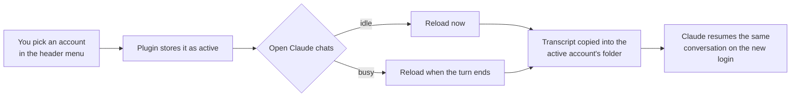

<div align="center">

# Claude accounts for Paseo

**Several Claude logins, one Claude provider, one click to switch.**

When one account hits its limit, switch to the next and keep going in the same chat, with the whole history.

[](https://paseo.sh)
[](https://docs.anthropic.com/en/docs/claude-code)
[](LICENSE)

</div>

---

## Why

Claude Code keeps one login per config directory. Paseo can run several of them as separate providers, but then every model shows up once per account in the pickers, and a chat stays stuck on the account it was started on.

This plugin keeps **one** Claude provider in Paseo and puts any number of logins behind it. You choose which login the next message goes out on; open chats move over with their history.

## Features

|  |  |
|---|---|
| **One provider in the pickers** | Every model shows once. The accounts live in the config but stay out of the pickers. |
| **Switch from the header** | A button in every workspace with a Claude chat shows the account in use and opens a native Paseo menu with each account and its usage. |
| **Chats keep their history** | Switching reloads open Claude chats on the new login and resumes the same conversation. Busy chats move once their turn ends. |
| **Usage at a glance** | Session (5h) and weekly usage per account, in the menu and in Paseo's own usage bar. |
| **Manage in Settings** | Add an account, sign it in (browser or code, works from your phone too), sign in again, or remove it. |

## Requirements

- [Paseo](https://paseo.sh) **0.17.x** (tested with 0.17.3), with plugins enabled
- [Claude Code](https://docs.anthropic.com/en/docs/claude-code) (`claude`) on your `PATH`: signing in runs `claude auth login`
- macOS or Linux. On Linux each login lives in `<CLAUDE_CONFIG_DIR>/.credentials.json`; on macOS in the Keychain
- `npm` on your `PATH` only when installing from GitHub: Paseo runs `npm ci` once. The release tarball needs neither npm nor network

## Install

```sh
paseo plugin install github:MaxGierlachowski/paseo-multi-account
```

On macOS the CLI ships inside the app: `/Applications/Paseo.app/Contents/Resources/bin/paseo`.

Paseo asks you to trust the plugin (plugins run unsandboxed), clones it, installs its dependencies and loads it. If nothing shows up, check that `~/.paseo/config.json` has `"pluginsEnabled": true` and restart Paseo.

### From the release tarball (offline)

`npm run release:tarball` builds `dist/paseo-multi-account-<version>.tgz` and a `.sha256` next to it. The tarball holds one folder, `paseo-multi-account/`, with the source and its production `node_modules`; it is platform independent and installs without network or npm. Paseo runs the plugin from the folder you install, so extract it somewhere permanent:

```sh
sha256sum -c paseo-multi-account-1.1.0.tgz.sha256
mkdir -p /opt/vendor/paseo-multi-account/1.1.0
tar xzf paseo-multi-account-1.1.0.tgz -C /opt/vendor/paseo-multi-account/1.1.0
paseo plugin install /opt/vendor/paseo-multi-account/1.1.0/paseo-multi-account --home "$PASEO_HOME"
paseo plugin ls claude-accounts-usage --home "$PASEO_HOME"    # STATUS: running
```

To upgrade, extract the new version into its own folder, then `paseo plugin remove claude-accounts-usage` and install the new folder; installing over a configured ID is refused. The accounts and `claude-accounts.json` are untouched by this.

## Getting started

1. Open **Settings → Plugins → Claude accounts**.
2. Under **Add account**, enter a name such as `Work` and press **Add**. The plugin adds a provider `claude-work` with its own `~/.claude-work` folder and starts the sign-in.
3. Finish the sign-in in the browser that opens, or open the link on any device and paste the code into the **Code** field.
4. Repeat for every login you have.
5. Start chats on the built-in **Claude** provider as usual. With two or more accounts, the account button appears in the workspace header.

## Everyday use

| You want to | Where |
|---|---|
| Switch account | Header button → pick an account |
| See usage per account | Header button, or Paseo's usage bar |
| Add an account | Settings → Plugins → Claude accounts → **Add account** |
| Sign in again (expired login) | Settings → Plugins → Claude accounts → **Sign in again** |
| Remove an account | Settings → Plugins → Claude accounts → **Remove** (not the one in use) |

Switching is global: new chats, reopened chats and every open Claude chat move to the chosen account.

## How it works



- Each account is a provider in `agents.providers` that extends `claude`, sets its own `CLAUDE_CONFIG_DIR` and is **disabled**, so it stays out of the pickers.
- Before Paseo opens any Claude session, the plugin points `CLAUDE_CONFIG_DIR` at the active account.
- Claude Code stores a conversation under the login that ran it. Before a chat reopens on another login, the plugin copies that one session's transcript over; the source is never changed.
- Removing an account only takes its provider out of the config. The login and its folder stay on disk, and the folder keeps being searched for transcripts, so old chats keep their history.

An account the plugin adds looks like this in `~/.paseo/config.json`:

```json
"claude-work": {
  "extends": "claude",
  "label": "Claude (Work)",
  "enabled": false,
  "env": { "CLAUDE_CONFIG_DIR": "/Users/you/.claude-work" },
  "options": { "extraArgs": { "chrome": null } }
}
```

More detail, including the internals, is in [OVERVIEW.md](OVERVIEW.md).

## Good to know

- **Start chats on Claude, not on an account provider.** Account providers are disabled, and a disabled provider's chats don't open (Paseo 0.17 refuses to create them: "Provider is disabled"). If you have chats created directly on one, set `"provider": "claude"` in their records under `~/.paseo/agents/` (top level, `runtimeInfo` and `persistence`) and restart Paseo.
- **No confirmation toast in the header menu.** Paseo's menus can't show one; the button's label changing to the new account is the confirmation.
- Plugin state (the active account, removed accounts' folders) lives in `~/.paseo/claude-accounts.json`.

## Update and uninstall

```sh
paseo plugin update claude-accounts-usage    # pull the latest version
paseo plugin remove claude-accounts-usage    # uninstall
```

Uninstalling leaves your accounts in `~/.paseo/config.json` and your logins in `~/.claude-<name>`.

## Headless Linux and automation

Everything the Settings screen does is also reachable without the app, so a host (a provisioning script, a config server) can manage the accounts. This section is the contract such a host can rely on. Paths are examples.

### Where things live

| What | Where |
|---|---|
| The accounts | `agents.providers.<id>` in `$PASEO_HOME/config.json` |
| Each account's login | Linux: `<CLAUDE_CONFIG_DIR>/.credentials.json`. macOS: Keychain item `Claude Code-credentials-<first 8 hex of sha256(dir)>`, the file as fallback |
| Plugin state | `$PASEO_HOME/claude-accounts.json` |
| CLI | `<plugin dir>/bin/paseo-claude-accounts.mjs` (Node 22 or newer) |

### Provider entry

An account is a provider entry that extends `claude` and sets its own `CLAUDE_CONFIG_DIR`:

```json
{
  "agents": {
    "providers": {
      "claude-work": {
        "extends": "claude",
        "label": "Claude (Work)",
        "enabled": false,
        "env": { "CLAUDE_CONFIG_DIR": "/srv/claude-accounts/claude-work" }
      }
    }
  }
}
```

- Every entry with `"extends": "claude"` and a non-empty `env.CLAUDE_CONFIG_DIR` is an account, in config order. Other entries are ignored.
- **ID (slug):** Paseo's provider alphabet, `^[a-z][a-z0-9-]*$` (a lowercase letter first; no uppercase, `_` or `.`). Not a built-in ID (`claude`, `codex`, `copilot`, `opencode`, `pi`, `omp`, `acp`). The Settings screen uses `claude-<name>`; any valid ID works.
- **`label`** is required by Paseo for an entry with `extends`. The plugin shows it as the account name.
- **`enabled: false`** keeps the model pickers at one Claude. A disabled provider cannot start chats; start every chat on the built-in `claude` provider and the plugin picks the account.
- **`CLAUDE_CONFIG_DIR`** is absolute (a leading `~/` is expanded against the daemon user's home), one directory per account, never shared by two entries.
- `options` is passed through. The plugin's own add sets `"options": { "extraArgs": { "chrome": null } }`; it is optional.

### `CLAUDE_CONFIG_DIR` layout

Claude Code owns this directory; the plugin only reads the login and copies transcripts between accounts.

```
<CLAUDE_CONFIG_DIR>/
  .credentials.json                       # Linux: the login, mode 0600, written by Claude Code only
  .claude.json                            # Claude Code's own settings and state
  projects/<encoded cwd>/<session>.jsonl  # transcripts; copied to the new account on a switch
  file-history/<session>/                 # rewind data, copied along
```

`.credentials.json` is `{"claudeAiOauth": {"accessToken", "refreshToken", "expiresAt" (epoch ms), "scopes", "subscriptionType", "rateLimitTier"}}`. A missing or unparseable file, or one without `accessToken`, reads as **Not logged in**; an `expiresAt` in the past reads as **Login expired**. The plugin never writes this file; Claude Code does, on sign-in and on refresh.

### `claude-accounts.json`

Written by the plugin (atomically, mode 0600):

| Field | Meaning |
|---|---|
| `version` | `1` |
| `activeAccountId` | Provider ID new and reopened Claude sessions run on. `null` or unknown: the first account |
| `agents` | Agent ID → account its live session last opened on. Bookkeeping for switching, not a pin |
| `retiredConfigDirs` | Directories of accounts removed through the plugin; still searched for transcripts |
| `identities` | Config directory → `{key, label}` of the login it last resolved to (account + organization, email) |

Hosts should not write this file. Use `switch` (below), which also moves open chats. A missing or invalid file reads as empty state.

### The CLI

`bin/paseo-claude-accounts.mjs` calls the plugin's RPCs through the local daemon, the way the `paseo` CLI connects: the address from `$PASEO_HOME/paseo.pid`, the local credential from `$PASEO_HOME/local-credential`. So it runs as the daemon's user, needs the daemon running, and prints JSON (errors on stderr, exit code 1).

```sh
ACCOUNTS="node /opt/vendor/paseo-multi-account/1.1.0/paseo-multi-account/bin/paseo-claude-accounts.mjs --home $PASEO_HOME"

$ACCOUNTS list [--usage] [--force]       # {accounts: [{id,label,configDir,email,active,usage}], activeId, providers}
$ACCOUNTS add <name> [--id <id>] [--config-dir <dir>]   # {accountId, configDir}
$ACCOUNTS switch <id>                    # {activeId, reloaded, deferred, failed}
$ACCOUNTS remove <id>                    # {accountId}
$ACCOUNTS login start <id>               # {accountId, status: "waiting", url, message}
printf '%s\n' "$CODE" | $ACCOUNTS login code <id>    # the code comes from stdin, never argv
$ACCOUNTS login status <id>
$ACCOUNTS login cancel <id>
```

`usage.status` in `list --usage` is `available` (windows filled), `unavailable` (not logged in, expired or rejected: sign in again; the UI disables switching to it) or `error` (the usage API failed or is unreachable; the message says why, the account stays usable). A broken login or an unreachable API never fails the list. Usage is cached for two minutes; `--force` bypasses that.

There is no HTTP route. The RPCs travel over the daemon WebSocket (`ws://<listen>/ws`) as `plugin.rpc.invoke` requests for plugin `claude-accounts-usage` and need the daemon's `daemon.manage` permission, which the local credential grants. Any client of `@getpaseo/client` can call them with `invokePluginRpc("claude-accounts-usage", "accounts.list", {...})`; the method names are in `shared/rpc.ts`.

### Add an account

1. Register it, either through the plugin (creates the directory with mode 0700 and writes the provider through the daemon, applied at once):

   ```sh
   $ACCOUNTS add Work --id claude-work --config-dir /srv/claude-accounts/claude-work
   ```

   or by writing the config yourself. `paseo daemon config set` cannot address `agents.providers.<id>`, so set the whole `agents.providers` object; the command saves and applies it to a running daemon:

   ```sh
   providers=$(jq -c '.agents.providers + {"claude-work": {extends: "claude", label: "Claude (Work)",
     enabled: false, env: {CLAUDE_CONFIG_DIR: "/srv/claude-accounts/claude-work"}}}' "$PASEO_HOME/config.json")
   paseo daemon config set --home "$PASEO_HOME" agents.providers "$providers"
   ```

   Read the current providers from `config.json` itself, not from `paseo daemon config get`: `get` redacts keys that look like secrets (`token`, `api_key`, ...), and writing that output back would destroy them.

2. Sign it in (next section), then check: `CLAUDE_CONFIG_DIR=/srv/claude-accounts/claude-work claude auth status` exits 0 with `"loggedIn": true` (1 and `false` without a login).

### Sign in

`login start` runs `claude auth login` (the Claude subscription login, Claude Code's default; same as `--claudeai`) inside the plugin process, with the account's `CLAUDE_CONFIG_DIR` and piped stdio (no PTY). It waits up to 15 s for the sign-in URL Claude Code prints (with Claude Code 2.1.x a short `https://claude.ai/oauth/authorize?<id>` link) and returns it with `status: "waiting"`. Open the URL in any browser, sign in, and the page shows a code. `login code` writes that code to Claude Code's stdin and waits up to 30 s: the result is `succeeded`, `failed` (with Claude Code's message), or `waiting` again so the code can be retried. A sign-in nobody finishes is stopped after 10 minutes. One sign-in runs per account; starting another replaces it. The sign-in lives in the plugin process, so `start` and `code` can be separate CLI calls, but a plugin reload or daemon restart cancels it. On success the account's cached usage is dropped.

A host may just as well run `claude auth login` itself with the account's `CLAUDE_CONFIG_DIR`; the plugin reads whatever login lands in the directory.

### Switch

`switch <id>` refuses an account without a login (`... is not signed in. Sign it in first.`). If the login expires within five minutes it is refreshed once first (`claude -p /cost`, which spends no quota), so reloading chats don't race each other with a single-use refresh token. Then the account becomes active: new and reopened Claude sessions get its `CLAUDE_CONFIG_DIR`. Idle open Claude chats are reloaded at once (`reloaded`), busy ones when their turn ends (`deferred`); each resumes the same conversation on the new login. If the daemon connection fails, the switch still holds and open chats move on their next reopen.

### Per-agent pinning

Not supported. The plugin sets `CLAUDE_CONFIG_DIR` on every session of `claude` and of every provider extending it, including an explicit `paseo agent run --env CLAUDE_CONFIG_DIR=...`, and disabled account providers cannot start chats. All Claude chats run on the active account.

### Remove

`remove <id>` refuses the active account and accounts that chats were created on directly. It deletes only the provider entry (applied at once); the directory and login stay and remain a transcript source. Deleting the entry from `config.json` by hand works too (then `paseo daemon reload`), without the transcript bookkeeping.

### When changes take effect

| Change | The plugin | The daemon |
|---|---|---|
| `add` / `remove` through the plugin | immediately | immediately (written and applied by the daemon) |
| `paseo daemon config set ... agents.providers` | immediately | immediately (the command reloads) |
| Hand edit of `config.json` | immediately (it reads the file on every call) | after `paseo daemon reload` (no restart) |
| A login written to `.credentials.json` | next read (usage is cached two minutes; `list --usage --force` rereads) | not involved |
| `switch` | new and reopened sessions; open chats are reloaded | not involved |

Only the plugin needs to know an account, so a hand edit already works for listing and switching; reload the daemon anyway so `paseo provider ls` agrees. After `paseo plugin install`, `paseo daemon reload` lists `plugins.claude-accounts-usage.*` under paths that need a restart; the plugin is already running and nothing needs restarting.

## Development

```sh
git clone https://github.com/MaxGierlachowski/paseo-multi-account.git
cd paseo-multi-account
npm install
npm run typecheck
npm test                       # node:test via tsx; Linux credential paths are simulated
npm run release:tarball        # dist/paseo-multi-account-<version>.tgz + .sha256
paseo plugin install "$PWD"    # install from your checkout; reload after changes
```

Paseo compiles the plugin itself (`index.server.ts` and `index.client.tsx`); there is no build output to commit.

## License

[Apache 2.0](LICENSE). Three files come unchanged from Paseo's built-in Claude usage source; see [NOTICE](NOTICE).
